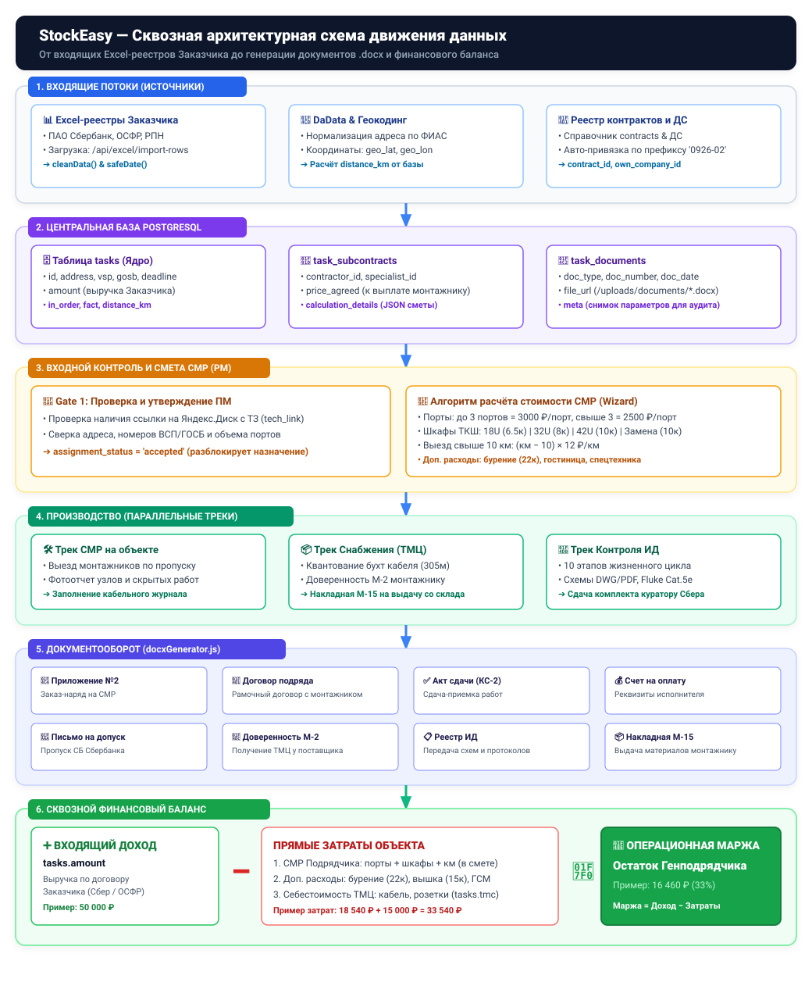
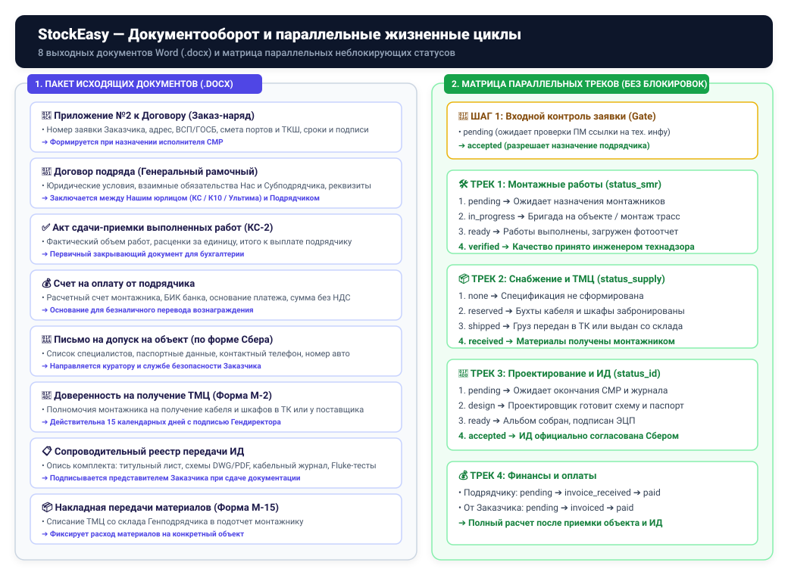

# StockEasy: Комплексная схема потоков данных и архитектура документооборота

> **Версия документа:** 2.4 (Production / Ревизия март-октябрь 2026)  
> **Статус:** Действующая архитектурная спецификация  
> **Область применения:** Backend (Node.js/Express, PostgreSQL), Frontend (Vanilla JS SPA), Документооборот (DOCX/XLSX), Финансовый контур и Снабжение

---

## 1. Юридическая и организационная архитектура

Система **StockEasy** автоматизирует полный производственно-финансовый цикл группы компаний, выступающих Генеральным подрядчиком по договорам монтажа и обслуживания структурированных кабельных сетей (СКС), локально-вычислительных сетей (ЛВС) и систем безопасности для государственных и корпоративных заказчиков.

### 1.1. Структура собственных юридических лиц («Мы» / Генподрядчик)
В базе данных ведется реестр собственных компаний группы (`own_companies`), под реквизитами которых заключаются генеральные контракты с Заказчиками и рамочные договоры с Субподрядчиками:

1. **ООО «Кабельные Системы» (`code: 'KS'`, `id: 1`)**
   - **ИНН/КПП:** `5406774300` / `540601001`, **ОГРН:** `1135476082260`
   - **Руководитель:** Генеральный директор Городович Милана Владимировна
   - **Юр. адрес:** 630099, г. Новосибирск, ул. Орджоникидзе, 40, оф. 3517
   - **Банк:** Филиал «Новосибирский» АО «АЛЬФА-БАНК», БИК `045004774`, р/с `40702810223130000540`
   - **Налоговый режим:** С НДС (`with_vat`). Основной профиль: ОСФР, Росприроднадзор, крупные коммерческие и государственные тендеры.
2. **ООО «К10» (`code: 'K10'`, `id: 2`)**
   - **ИНН/КПП:** `5401995659` / `547301001`, **ОГРН:** `1195476081234`
   - **Руководитель:** Генеральный директор Городович Илья Олегович
   - **Юр. адрес:** 630090, г. Новосибирск, пр-кт Академика Лаврентьева, д. 2/2, оф. 126
   - **Банк:** ПАО Сбербанк России «Сибирский банк», БИК `045004641`, р/с `40702810244050054706`
   - **Налоговый режим:** УСН / Без НДС (`without_vat`). Основной профиль: ПАО Сбербанк (программа модернизации и текущего обслуживания отделений).
3. **ООО «Ультима» (`code: 'ULTIMA'`, `id: 3`)**
   - **ИНН/КПП:** `7810754890` / `781001001`, **ОГРН:** `1197847089123`
   - **Руководитель:** Генеральный директор Чайка Алексей Владимирович
   - **Юр. адрес:** 196084, г. Санкт-Петербург, Московский пр-кт, д. 100, лит. А
   - **Банк:** ПАО СБЕРБАНК г. Москва, БИК `044525225`, р/с `40702810938000012345`
   - **Налоговый режим:** С НДС (`with_vat`). Профиль: Северо-Западный регион, специальные инженерные проекты.

### 1.2. Классификация внешних контрагентов (`contractors.type`)
Все внешние контрагенты разделены на 4 функциональных типа:
- **`customer` (Заказчики):** ПАО Сбербанк (ИНН `7707083893`), ОСФР по Архангельской обл. (ИНН `2901004169`), Росприроднадзор и др.
- **`subcontractor` (Подрядчики и самозанятые):** Непосредственные исполнители строительно-монтажных работ (СЗ Хомич А.И., СЗ Елагин В.И., ИП и монтажные бригады в регионах).
- **`supplier` (Поставщики ТМЦ):** ТД «Телеком-Снаб», ЭТМ, Русский Свет, ЛКС Кабель-Системы, СпецЭлектроКомплект.
- **`logistics` (Транспортные компании):** Деловые Линии, СДЭК, ПЭК, ЖелДорЭкспедиция, Витэка.

---

## 2. Сквозная архитектурная схема движения данных (End-to-End Pipeline)



---

## 3. Физическая модель данных (Реляционная схема PostgreSQL)

### 3.1. Ядро заявок и объектов: Таблица `tasks`
Центральная сущность производственного учета. Хранит как исходные данные заявки Заказчика, так и агрегированные показатели выполнения.

| Колонка | Тип данных | Описание и бизнес-роль |
| :--- | :--- | :--- |
| `id` | `TEXT PRIMARY KEY` | Уникальный номер заявки (например, `0926-02-001`, `СЗБ-26-0491`) |
| `sheet` | `TEXT` | Наименование листа исходного Excel-файла (например, `Сбербанк 2026`) |
| `region` | `TEXT` | Регион производства работ (например, `Архангельская область`, `Тюменская область`) |
| `address` | `TEXT` | Полный фактический адрес объекта Заказчика |
| `clean_address` | `TEXT` | Нормализованный адрес после геокодинга в DaData |
| `geo_lat`, `geo_lon`| `TEXT` | Географические координаты объекта (широта, долгота) |
| `distance_km` | `NUMERIC DEFAULT 0` | Удаленность от базового города/склада (км) |
| `work_type` | `TEXT` | Наименование работ по заданию Заказчика |
| `tip_obj` | `TEXT` | Тип объекта (ВСП, ГОСБ, Офис, Архив, ЦОД) |
| `gosb`, `vsp` | `TEXT` | Номер отделения ГОСБ и номер офиса ВСП |
| `date_zayavki` | `DATE` | Дата поступления заявки от Заказчика |
| `deadline` | `DATE` | Предельный нормативный срок выполнения работ |
| `data_vyhoda` | `DATE` | Согласованная дата фактического выхода монтажников на объект |
| `manager` | `TEXT` | ФИО ответственного куратора от Заказчика |
| `contractor` | `TEXT` | Краткое наименование назначенного исполнителя (синхронизируется с `task_subcontracts`) |
| `in_order` | `INTEGER DEFAULT 0` | Заявленное количество портов/точек СКС по ТЗ Заказчика |
| `fact` | `INTEGER DEFAULT 0` | Фактически смонтированное количество портов (по акту) |
| `amount` | `NUMERIC DEFAULT 0` | **Входящая выручка:** сумма, которую Заказчик платит Генподрядчику за объект |
| `price_per_unit` | `NUMERIC DEFAULT 0` | Тариф за единицу (порт) по генеральному контракту Заказчика |
| `km_rate` | `NUMERIC DEFAULT 0` | Компенсация транспортных расходов от Заказчика |
| `tmc` | `NUMERIC DEFAULT 0` | Себестоимость израсходованных материалов (ТМЦ) |
| `extras` | `NUMERIC DEFAULT 0` | Сумма дополнительных расходов по объекту |
| `tech_link` | `TEXT` | Ссылка на Яндекс.Диск с технической документацией и схемами Заказчика |
| `contract_id` | `INTEGER REFERENCES contracts(id)` | Ссылка на Генеральный договор с Заказчиком |
| `own_company_id` | `INTEGER REFERENCES own_companies(id)` | Собственное юрлицо («Мы»), ведущее этот объект (1 = КС, 2 = К10, 3 = Ультима) |
| `assignment_status` | `TEXT` | Статус входного контроля: `pending` (ожидает проверки ПМ) / `accepted` (допущено к назначению) |
| `status` | `TEXT` | Общий статус (`new`, `assigned`, `progress`, `control`, `done`, `cancelled`) |
| `stage` | `TEXT` | Макро-этап (`request`, `survey`, `install`, `control`, `acceptance`, `payment`) |
| `stage_num` | `INTEGER DEFAULT 0` | Числовой этап трека исполнительной документации (0..9) |
| `macro_status` | `TEXT` | Единый сквозной статус (`new`, `assigned`, `install`, `id_in_progress`, `id_delivered`, `accepted`, `paid`) |
| **Параллельные статусы** | | |
| `status_smr` | `TEXT DEFAULT 'pending'` | Статус строительно-монтажных работ (`pending`, `in_progress`, `ready`, `verified`) |
| `status_supply` | `TEXT DEFAULT 'none'` | Статус обеспечения материалами (`none`, `reserved`, `shipped`, `received`) |
| `status_id` | `TEXT DEFAULT 'pending'` | Статус исполнительной документации (`pending`, `design`, `ready`, `delivered`, `accepted`) |
| `status_acts` | `TEXT DEFAULT 'pending'` | Статус подписания первичных актов (`pending`, `generated`, `signed_sub`, `signed_cust`) |
| `status_payment_sub`| `TEXT DEFAULT 'pending'`| Статус расчетов с субподрядчиком (`pending`, `invoice_received`, `approved`, `paid`) |
| `status_payment_customer`|`TEXT DEFAULT 'pending'`| Статус поступления оплаты от Заказчика (`pending`, `invoiced`, `partial`, `paid`) |

---

### 3.2. Контур субподряда: Таблица `task_subcontracts`
Фиксирует юридическое поручение на выполнение СМР между Генподрядчиком и Подрядчиком на конкретном объекте.

| Колонка | Тип данных | Описание |
| :--- | :--- | :--- |
| `id` | `SERIAL PRIMARY KEY` | Внутренний номер субподрядного поручения |
| `task_id` | `TEXT REFERENCES tasks(id)` | Ссылка на заявку/объект |
| `contractor_id` | `INTEGER REFERENCES contractors(id)` | Ссылка на контрагента-исполнителя |
| `own_company_id` | `INTEGER REFERENCES own_companies(id)` | Собственное юрлицо-Генподрядчик в договоре |
| `contractor_contract_id` | `INTEGER REFERENCES contractor_contracts(id)`| Рамочный договор подряда между Нами и Исполнителем |
| `price_list_id` | `INTEGER REFERENCES contractor_price_lists(id)`| Протокол договорной цены (Приложение №1 к договору подряда) |
| `work_type` | `TEXT` | Наименование поручаемых работ |
| `price_agreed` | `NUMERIC DEFAULT 0` | **Согласованная стоимость СМР:** итого к выплате подрядчику |
| `assigned_date` | `DATE` | Дата выдачи заказ-наряда |
| `deadline` | `DATE` | Нормативный дедлайн завершения работ монтажником |
| `specialist_id` | `INTEGER REFERENCES specialists(id)` | Назначенный специалист (монтажник/бригадир) |
| `installer_fio` | `TEXT` | ФИО монтажника (для пропуска и заказ-наряда) |
| `installer_phone` | `TEXT` | Телефон монтажника для оперативной связи |
| `installer_passport`| `TEXT` | Паспортные данные монтажника (серия, номер, кем/когда выдан) |
| `auto_number` | `TEXT` | Марка и госномер автотранспорта монтажника |
| `calculation_details` | `JSONB DEFAULT '{}'` | **Полный детализированный расчет:** массив позиций `lines` (порты, шкафы, км) и `third_party_lines` (доп. расходы) |
| `ports_count` | `INTEGER DEFAULT 0` | Количество портов, включенных в расчет |
| `distance_km` | `NUMERIC DEFAULT 0` | Тарифицируемый километраж по объекту |
| `status` | `TEXT DEFAULT 'assigned'` | Статус подряда (`assigned`, `in_progress`, `done`, `accepted`, `paid`) |

---

### 3.3. Структура JSON-поля `calculation_details` в `task_subcontracts`
Для обеспечения 100% прозрачности финансового аудита калькулятор сохраняет структуру сметы объекта в структурированном виде:

```json
{
  "contractId": 4,
  "contractNumber": "СКС СЗ 090626",
  "contractDate": "2026-06-09",
  "ownCompanyId": 2,
  "ownCompanyName": "ООО \"К10\"",
  "priceListId": 3,
  "lines": [
    {
      "work_code": "port_5e",
      "name": "Базовая стоимость работ 1 порт СКС 5е (шкала: >3 шт)",
      "qty": 4,
      "unit": "порт",
      "price": 2500,
      "sum": 10000,
      "tier": 2
    },
    {
      "work_code": "tksh_32u",
      "name": "Монтаж напольного ТКШ 32U",
      "qty": 1,
      "unit": "шт",
      "price": 8000,
      "sum": 8000
    },
    {
      "work_code": "km_rate",
      "name": "Транспортные расходы (компенсация проезда авто свыше 10 км: 45 км × 12 ₽)",
      "qty": 45,
      "unit": "км",
      "price": 12,
      "sum": 540
    }
  ],
  "third_party_lines": [
    {
      "name": "Алмазное бурение технологических отверстий",
      "performer": "Специалист по алмазному бурению",
      "payment_type": "through_contractor",
      "contract_info": "Договор / чек",
      "amount": 22000
    },
    {
      "name": "Аренда автовышки с машинистом",
      "performer": "ООО \"СпецАвтоТранс\"",
      "payment_type": "direct",
      "contract_info": "Договор аренды спецтехники №44",
      "amount": 15000
    }
  ],
  "summary": {
    "totalSmrWorks": 18000,
    "totalTransport": 540,
    "contractorSmrTotal": 18540,
    "thirdPartyViaContractor": 22000,
    "thirdPartyDirect": 15000,
    "totalSubcontractPayout": 40540,
    "totalSiteExpenses": 55540
  }
}
```

---

### 3.4. Реестр сгенерированных документов: Таблица `task_documents`

| Колонка | Тип | Назначение |
| :--- | :--- | :--- |
| `id` | `SERIAL PRIMARY KEY` | Идентификатор записи |
| `task_id` | `TEXT REFERENCES tasks(id)` | Ссылка на заявку |
| `subcontract_id` | `INTEGER REFERENCES task_subcontracts(id)`| Ссылка на субподряд (если документ субподрядный) |
| `doc_type` | `TEXT NOT NULL` | Тип документа (`order_subcontract`, `contract`, `completion_act`, `invoice`, `permit_letter`, `power_attorney`, `id_registry`, `tmc_act`) |
| `doc_number` | `TEXT` | Официальный номер документа (например, `ЗН-0926-02-001-1`, `АКТ-0926-02-001-1`, `ИСХ-0926-02-001-ДОП`) |
| `doc_date` | `DATE DEFAULT CURRENT_DATE` | Дата формирования документа |
| `title` | `TEXT NOT NULL` | Человекочитаемое наименование документа |
| `file_url` | `TEXT NOT NULL` | Путь к сгенерированному файлу на диске сервере (`/uploads/documents/...docx`) |
| `file_type` | `TEXT DEFAULT 'docx'` | Формат файла |
| `meta` | `JSONB DEFAULT '{}'` | Снимок параметров, переданных в генератор |
| `created_by` | `INTEGER REFERENCES users(id)` | Пользователь, сформировавший документ |

---

## 4. Матрица трассируемости данных (Data Traceability Matrix)

Таблица показывает, **откуда конкретное поле поступает**, **где хранится в БД**, **в каких формулах участвует** и **в какие документы переносится**.

| Бизнес-параметр | Источник поступления | Таблица и поле БД | Формула / Алгоритм | Выходные документы (.docx) |
| :--- | :--- | :--- | :--- | :--- |
| **Номер заявки** | Реестр Excel / Заказчик | `tasks.id` | Прямой маппинг при парсинге | Все документы (Заказ-наряд, КС-2, Счет, Письмо на допуск, Реестр ИД) |
| **Адрес объекта** | Реестр Excel ➔ DaData | `tasks.address`, `clean_address` | Геокодирование, нормализация ФИАС | Заказ-наряд (таблица объекта), Письмо на допуск, КС-2, Накладная М-15 |
| **Офис ВСП / ГОСБ** | Реестр Excel | `tasks.vsp`, `tasks.gosb` | Прямой маппинг | Заказ-наряд, Письмо на допуск куратору Сбера, Реестр ИД |
| **Выручка Заказчика** | Реестр Excel / Контракт | `tasks.amount` | Фиксированная сумма контракта Заказчика | Финансовый дашборд, расчёт маржи объекта |
| **Количество портов** | Реестр Excel / ПМ | `tasks.in_order`, `fact` | Проверка шкалы объема: до 3 портов включительно или более 3 | Заказ-наряд (объем работ), КС-2, Счет |
| **Тариф за порт СМР** | Прайс-лист подрядчика (`price_list_items`) | `price_list_items.price_tier_1`, `price_tier_2` | Если портов > 3 ➔ 2 500 ₽ (тир 2), иначе 3 000 ₽ (тир 1) | Заказ-наряд (Приложение №2), КС-2 (расценка) |
| **Шкаф ТКШ** | Чек-лист обследования / Задание | `calculation_details.lines` | Фиксированный тариф по типу шкафа (42U=10к, 32U=8к, 18U=6.5к) | Заказ-наряд, КС-2, Счёт |
| **Удаленность объекта** | DaData / Яндекс.Карты | `tasks.distance_km` | Если удаленность > 10 км ➔ (км − 10) × 12 ₽ | Заказ-наряд (строка транспортных расходов), КС-2 |
| **Дополнительные расходы** | Ручной ввод ПМ / Счета | `calculation_details.third_party_lines` | Суммирование в смету с признаком плательщика | Заказ-наряд (если платит Подрядчик), Финансовый баланс |
| **Генподрядчик («Мы»)** | Привязка контракта / ПМ | `own_companies` (1=КС, 2=К10, 3=Ультима) | Выбор юрлица по договору и режиму НДС | Шапка и реквизиты всех 8 документов Word |
| **Субподрядчик** | Назначение ПМ | `contractors`, `task_subcontracts` | Справочник контрагентов, проверка ИНН/р/с | Преамбула и реквизиты Заказ-наряда, Договора, КС-2, Счета |
| **Специалист СМР** | Справочник монтажников | `specialists`, `task_subcontracts` | ФИО, телефон, паспорт, автотранспорт | Письмо на допуск Сбера, Доверенность М-2, Накладная М-15 |
| **Материалы (ТМЦ)** | Норматив СКС / Склад | `task_materials`, `materials` | Квантование бухт (305м), остатки складов | Накладная М-15, Доверенность М-2 |

---

## 5. Алгоритмы расчёта и бизнес-формулы

### 5.1. Дифференцированная шкала стоимости портов СКС (Приложение №1)
В соответствии с официальными тарифными протоколами группы (для Сбербанка, ОСФР и Росприроднадзора) действует правило объема:

> 🔹 **Категория 5е:**
> - При объеме **от 1 до 3 портов:** `3 000 руб./порт`
> - При объеме **свыше 3 портов:** `2 500 руб./порт`
> 
> 🔹 **Категория 6 / 6А и оптические порты (дуплекс 2 волокна):**
> - При объеме **от 1 до 3 портов:** `3 500 руб./порт`
> - При объеме **свыше 3 портов:** `3 000 руб./порт`
> 
> **Формула расчета:**  
> `Стоимость работ по портам = Количество портов × Тариф шкалы`

### 5.2. Транспортные расходы (Выезд свыше 10 км)
В черте города и в радиусе до 10 км от базового города подрядчика транспортные расходы включены в базовую ставку монтажа. При удаленности свыше 10 км начисляется километраж по ставке **12 ₽/км**:

> 🚗 **Правило компенсации проезда автотранспорта:**
> - Если `Удаленность <= 10 км` => **0 руб.** (включено в базовый монтаж)
> - Если `Удаленность > 10 км` => `(Километраж − 10 км) × 12 руб./км`
> 
> *Пример:* расстояние 55 км => (55 − 10) × 12 = 45 × 12 = **540 руб.**

### 5.3. Стоимость монтажа и замены шкафов ТКШ
- Монтаж напольного ТКШ 42–48U (800х800): **10 000 руб.**
- Монтаж напольного ТКШ 32U (600х600 / 800х800): **8 000 руб.**
- Монтаж навесного ТКШ 18–22U: **6 500 руб.**
- Замена существующего ТКШ с перемонтажом оборудования: **10 000 руб.**
- Перешивка портов при замене ТКШ: **500 руб./порт**
- Демонтаж напольного ТКШ 42U: **7 000 руб.**
- Демонтаж напольного ТКШ 32U: **6 000 руб.**
- Демонтаж навесного ТКШ до 22U: **5 000 руб.**
- Модернизация шкафа (600мм / 800мм): **3 000 руб.**

### 5.4. Классификация дополнительных расходов по объекту
На объектах регулярно возникают сопутствующие работы сторонних специалистов. Система четко разделяет два механизма оплаты:
1. **`through_contractor` (Через подрядчика в смете):** Сумма добавляется в Заказ-наряд монтажника. Подрядчик оплачивает услугу на месте (или выполняет своими силами), а Генподрядчик компенсирует ее по акту КС-2.
   - *Примеры:* Алмазное бурение (типовой тариф **22 000 руб.**), суточные монтажника (**700 руб./день**), проживание в гостинице, ГСМ.
2. **`direct` (Прямая оплата Генподрядчиком «Мы»):** Генподрядчик заключает прямой договор со сторонней организацией (или поставщиком услуг) и оплачивает со своего расчетного счета. Монтажнику эта сумма в смету **не начисляется**, но вычитается из общей маржинальности объекта.
   - *Примеры:* Аренда спецтехники / автовышки с машинистом (**15 000 руб.**), доставка крупногабаритных грузов транспортной компанией.

### 5.5. Формула сквозного финансового баланса объекта

> 💎 **Сквозной расчет финансов по объекту:**
> 
> 1. `Итого к выплате Подрядчику (СМР) = Сумма СМР-работ + Доп. расходы (в смете подрядчика)`
> 2. `Общие прямые затраты = Итого Подрядчику + Доп. расходы (напрямую Генподрядчиком) + Себестоимость ТМЦ`
> 3. `Чистый операционный остаток (Маржа) = tasks.amount (Выручка Заказчика) − Общие прямые затраты`
> 4. `Рентабельность объекта (%) = (Чистый операционный остаток / tasks.amount) × 100%`

---

## 6. Движок генерации документов (`server/services/docxGenerator.js`)

Генерация документов выполняется программно на сервере с использованием библиотеки `docx`, что гарантирует строгую типографику, соответствие ГОСТам делопроизводства и отсутствие зависимостей от сторонних офисных пакетов.



### 6.1. Состав и назначение генерируемых документов

1. **Заказ-наряд (Приложение №2 к Договору субподряда)**
   - *Функция:* Официальное техническое задание и протокол цены на конкретный объект.
   - *Данные:* Реквизиты сторон (Генподрядчик и Подрядчик), номер заявки Заказчика, адрес, ВСП, ГОСБ, объем работ (порты, шкафы), согласованные сроки начала и окончания, итоговая цена с указанием неначисления НДС (УСН), таблица подписей и печатей.
2. **Письмо о согласовании допуска на объект (для службы безопасности Заказчика)**
   - *Функция:* Пропускной лист для беспрепятственного прохода монтажников на охраняемые объекты Сбербанка.
   - *Данные:* Адрес объекта, номер ВСП, даты проведения работ, таблица специалистов (ФИО, серия/номер паспорта, кем и когда выдан, контактный телефон, марка и госномер автомобиля), ФИО ответственного за охрану труда и ТБ.
3. **Доверенность на получение ТМЦ (Типовая форма М-2)**
   - *Функция:* Полномочия монтажника на получение кабельной продукции и оборудования со склада поставщика (ТД «Телеком-Снаб», ЭТМ) или терминала транспортной компании.
   - *Данные:* Доверитель (Генподрядчик), паспортные данные поверенного специалиста, наименование поставщика, спецификация получаемых ТМЦ.
4. **Сопроводительный реестр передачи исполнительной документации (Реестр ИД)**
   - *Функция:* Акт приема-передачи комплекта исполнительной документации куратору Заказчика.
   - *Данные:* Титульный лист, исполнительные схемы (DWG/PDF), кабельный журнал, протоколы измерений Fluke Networks Cat.5e PASS, фотоальбом скрытых и открытых работ.
5. **Договор подряда (Генеральный рамочный)**
   - *Функция:* Базовый гражданско-правовой договор между Нашим юрлицом и Субподрядчиком со всеми юридическими условиями, взаимной ответственностью и реквизитами расчетных счетов.
6. **Акт сдачи-приемки выполненных работ (КС-2)**
   - *Функция:* Закрывающий бухгалтерский документ на выполненный объем работ для выплаты вознаграждения подрядчику.
7. **Счет на оплату от подрядчика**
   - *Функция:* Платежный документ с банковскими реквизитами Подрядчика для бухгалтерии Генподрядчика.
8. **Накладная / Акт приема-передачи ТМЦ (Форма М-15)**
   - *Функция:* Фиксация выдачи материалов со склада Генподрядчика в подотчет монтажнику.

---

## 7. Жизненный цикл заявки и матрица параллельных статусов

Для устранения блокировок между отделами в системе реализована **неблокирующая параллельная модель статусов** (визуализирована на схеме выше):

| Производственный трек | Статусная цепочка | Бизнес-правило и условие перехода |
| :--- | :--- | :--- |
| **🚦 Входной контроль (Gate)** | `pending` ➔ `accepted` | Проверка ПМ наличия ТЗ, адреса и ссылки на документацию перед допуском к распределению |
| **🛠️ Трек СМР (`status_smr`)** | `pending` ➔ `in_progress` ➔ `ready` ➔ `verified` | Работы на объекте, загрузка фотоотчета, инспекционный контроль инженера технадзора |
| **📦 Трек Снабжения (`status_supply`)** | `none` ➔ `reserved` ➔ `shipped` ➔ `received` | Резерв кабеля/шкафов на складе, отгрузка в ТК, подтверждение получения монтажником |
| **📐 Трек ИД (`status_id`)** | `pending` ➔ `design` ➔ `ready` ➔ `delivered` ➔ `accepted` | Подготовка исполнительных схем, кабельного журнала, сдача комплекта куратору Заказчика |
| **💰 Взаиморасчеты с подрядчиком** | `pending` ➔ `invoice_received` ➔ `approved` ➔ `paid` | Оплата согласуется только после подтверждения СМР (`verified`) и сдачи ИД (`ready`) |
| **🏛️ Оплата от Заказчика** | `pending` ➔ `invoiced` ➔ `partial` ➔ `paid` | Выставление счета Заказчику после подписания КС-2/КС-3 и приемки ИД |

### 7.1. Правила перехода между этапами
1. **Входной контроль (Gate 1):** Без подтверждения ПМ заявка находится в статусе `assignment_status = 'pending'`. Кнопки назначения подрядчика и утверждения сметы заблокированы.
2. **Снабжение и СМР не ждут друг друга:** Подрядчик может выйти на обследование или прокладку трасс, пока склад комплектует кванты кабеля.
3. **Исполнительная документация (ИД):** Подготовка альбома схем начинается сразу после загрузки фотоотчета и кабельного журнала монтажником (`status_smr = 'ready'`).
4. **Финансовое закрытие:** Оплата субподрядчику (`status_payment_sub = 'paid'`) согласуется после подтверждения качества работ инженером технадзора (`status_smr = 'verified'`) и комплектности ИД (`status_id = 'ready'`).

---

## 8. Итоги и эксплуатационные гарантии

1. **Отсутствие вымышленных сущностей:** Вся схема опирается исключительно на существующие таблицы PostgreSQL (`tasks`, `task_subcontracts`, `contractor_contracts`, `price_list_items`, `own_companies`, `task_documents`) и рабочие функции бэкенда.
2. **Защита финансовых данных:** Поле `tasks.amount` (выручка от Заказчика) изолировано от субподрядных расчетов и не перезаписывается сметой подрядчика.
3. **Автоматическая синхронизация:** Изменение подрядчика или сметы в мастере моментально обновляет `tasks.contractor`, строку в `task_subcontracts` и финансовые сводки дашборда.
4. **Готовность к аудиту:** Любой сгенерированный документ (.docx) полностью воспроизводим из сохраненного слепка параметров в `task_documents.meta` и `task_subcontracts.calculation_details`.
